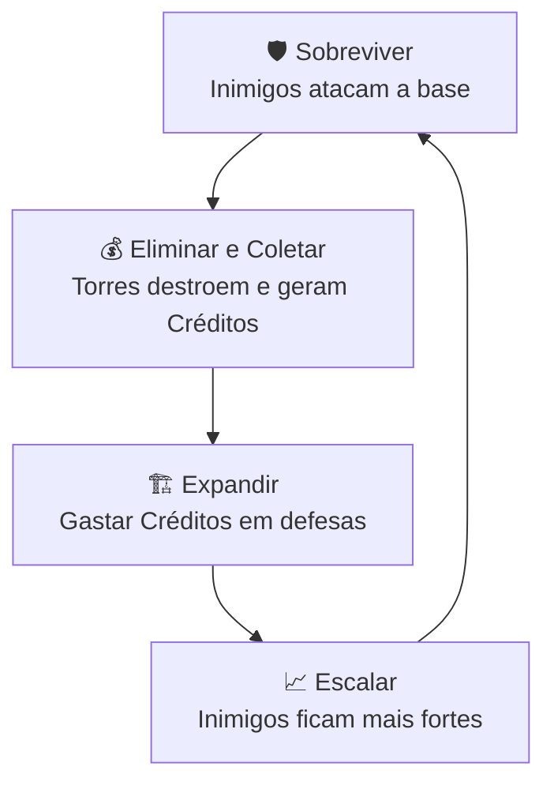

# 🎮 Game Design Document (GDD)
**Nome Provisório:** Projeto TD Neon

---

## 1. 👁️ Visão Geral

- **Gênero:** Tower Defense (Estratégia)
- **Temática:** Futurista / Sci-Fi
- **Estilo Visual:** Pixel Art (Visão Top-Down ou Isométrica simples)
- **Engine:** Godot 4 (GDScript)
- **Plataforma Alvo:** PC
- **Objetivo do Jogo:** Defender o núcleo da base contra ondas infinitas (ou pré-definidas) de invasores cibernéticos, gerenciando recursos para construir e melhorar defesas.

---

## 2. 🔄 Core Loop (O Ciclo Principal)

- **🛡️ Sobreviver:** Inimigos percorrem uma rota fixa em direção à base do jogador.
- **💰 Eliminar e Coletar:** Torres destroem inimigos, que dropam recursos (*Créditos*) no `GameManager`.
- **🏗️ Expandir:** O jogador gasta *Créditos* para construir novas torres no cenário.
- **📈 Escalar:** O jogo avança para a próxima onda, aumentando a vida/quantidade dos inimigos.

---

## 3. ⚙️ Entidades e Mecânicas

### 🏰 A Base do Jogador
- Fica no final do trajeto (`Path2D`).
- Possui **20 pontos de vida**.
- Perde **1 ponto de vida** para cada inimigo que cruza a linha de chegada.
- **Condição de Derrota:** Vida chega a 0 (Game Over).

### 💳 A Economia
- Gerenciada globalmente por um **Singleton/Autoload**.
- **Saldo Inicial:** X Créditos (suficiente para as primeiras defesas).
- Inimigos abatidos por projéteis adicionam Créditos à carteira.
- *Nota:* Inimigos que atingem a base **não** dão recompensa.

### 👾 Os Inimigos
- **Movimentação:** Seguem um caminho restrito e fixo de forma automática.
- **Status Básicos:** Velocidade de movimento, Vida Máxima e Valor de Recompensa.
- **Comportamento:** Não atacam as torres, seu único objetivo é chegar à base do jogador.

### 🗼 As Torres
- **Construção:** O jogador clica com o botão esquerdo no cenário para instanciar a torre, consumindo Créditos. *(Futuramente: restrição de construção por Grid)*.
- **Detecção:** Possuem um raio de visão (`Area2D`). O primeiro inimigo a entrar no raio torna-se o alvo.
- **Ataque:** Disparam projéteis balísticos (Lasers) em intervalos de tempo baseados em sua cadência de tiro (*Fire Rate*).

---

## 4. 📈 Dificuldade e Progressão (Wave Manager)

- **🌊 Ondas (Waves):** Os inimigos nascem em intervalos regulares controlados por um Timer.
- **⚖️ Escala de Poder:** A cada nova onda, a vida máxima (`max_health`) dos inimigos é multiplicada por um fator de escala, exigindo que o jogador construa mais torres ou melhore as existentes.

---

## 5. 🎨 Escopo de Arte e Áudio (MVP)

| Elemento | Descrição (Minimum Viable Product) |
| :--- | :--- |
| **🗺️ Cenário** | Um `TileMap` simples com chão de metal/tecnológico e uma rota destacada (ex: esteira ou trilha de neon). |
| **🗼 Torre Base** | Um canhão rotativo simples em pixel art. |
| **☄️ Projétil** | Um traço de pixel art emissivo (brilhante). |
| **🤖 Inimigo Base** | Um robô ou drone simples com animação de movimento de 2 a 4 frames. |
| **📊 UI (Interface)**| Apenas o contador de Vida, saldo de Créditos e o número da Onda atual no topo da tela. |
