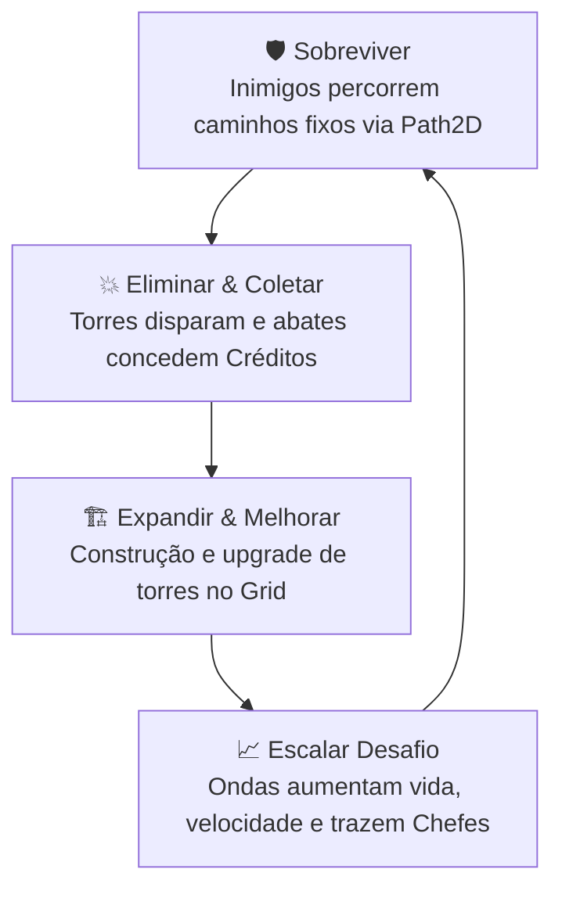

# 🎮 Projeto TD Neon - Tower Defense 2D


Jogo de estratégia **Tower Defense 2D** com estética sci-fi e temática neon futurista, desenvolvido na **Godot Engine 4 (GDScript)**. O objetivo é proteger o núcleo da base contra hordas de invasores cibernéticos em rotas táticas, gerenciando créditos para posicionar defesas e aplicar melhorias estratégicas.

---

## 📋 Sumário
- [Visão Geral & Core Loop](#-visão-geral--core-loop)
- [Funcionalidades e Mecânicas Implementadas](#-funcionalidades-e-mecânicas-implementadas)
- [Controles e Comandos](#-controles-e-comandos)
- [Arquitetura e Gerenciadores Globais](#-arquitetura-e-gerenciadores-globais)
- [Fases e Mapas](#-fases-e-mapas)
- [Estrutura do Repositório](#-estrutura-do-repositório)
- [Como Executar o Projeto](#-como-executar-o-projeto)

---

## 🔄 Visão Geral & Core Loop



---

## ✨ Funcionalidades e Mecânicas Implementadas

### 🏰 1. Base do Jogador & Sistema de Vida
- **Integridade do Núcleo:** Inicia com 20 pontos de vida gerenciados globalmente.
- **Dano por Inimigo Comum:** Cada invasor que atinge a base reduz 1 ponto de vida e é consumido sem conceder créditos.
- **Dano Fatal de Chefe:** Invasores da classe *Boss* causam destruição letal instantânea (999 de dano).
- **Desgaste Visual da Base:** O sprite do núcleo altera dinamicamente entre 4 estágios visuais conforme sua porcentagem de vida (>75%, >50%, >25%, <25%).
- **Feedback Sensorial:** Disparo de *Camera Shake* (tremor de tela) e SFX de alarme/impacto ao ser atingida.

### 💰 2. Economia e Gerenciamento de Créditos
- Saldo inicial de **100 créditos** para as primeiras defesas.
- **Recompensas por Abate:** +10 créditos por inimigo comum e +150 créditos por chefe abatido.
- Reconciliação em tempo real na interface com eventos reativos via sinais Godot.

### 🗼 3. Sistema de Torres e Construção em Grade
- **Posicionamento na Grade (Grid):** Alinhamento perfeito ao centro das células do `TileMap` / `TileMapLayer` via `map_to_local()`.
- **Bloqueio Automático de Trajeto:** Amostra com alta precisão (`sample_baked` a cada 8px) as curvas de todos os `Path2D`, impedindo qualquer construção sobre a rota dos inimigos.
- **Custo de Construção:** 50 créditos por torre.
- **Sistema de Upgrade (Nível 1):** Clicar com o botão esquerdo sobre uma torre já construída realiza o aprimoramento por 100 créditos:
  - Dobra o dano do projétil.
  - Aumenta a cadência de tiro em 25%.
  - Expande o raio de alcance em 10%.
  - Altera o tom visual (`modulate`) da torre e dos projéteis para amarelo/dourado neon.
- **Sistema de Venda (Sell):** Clicar com o botão direito sobre uma torre desfaz a construção e reembolsa **50% de todo o custo investido** (base + upgrade).
- **Mira Inteligente em 8 Direções:** Prioriza o inimigo mais avançado no caminho (`PathFollow2D.progress`), com rotação do sprite em 8 direções de 45°.

### 👾 4. Inimigos, Miniboss e Chefes Finais
- **Inimigo Comum:** Segue a rota do `Path2D`, com rotação em 8 direções e barra de vida (`ProgressBar`).
- **Status Imutáveis por Onda:** Vida e velocidade são vinculadas e congeladas estritamente à sua onda de origem (`inicializar_status_onda`), garantindo que chamar novas ondas não modifique os monstros já presentes no cenário.
- **Miniboss Intermediário (Onda 5):** O último inimigo da 5ª onda é o *Miniboss Sentinela*, com atributos aumentados e aviso visual na tela.
- **Chefes Finais Duplos (Onda 10):** Os dois últimos inimigos da 10ª onda são os bosses *Giga Invasor Alpha* e *Giga Invasor Beta*, com 800+ de vida, notificação de emergência e dano fatal caso alcancem a base.

### 🌊 5. Gerenciador de Ondas (WaveManager)
- Total de **10 ondas progressivas** por fase.
- Escalonamento progressivo de vida (fator 1.2x) e velocidade (fator 1.1x).
- Contagem dinâmica de inimigos: `5 + (onda - 1) * 2`.
- Suporte a múltiplos caminhos de entrada (ex: rotas superior e inferior alternadas no `Level_1`).
- **Convocação Antecipada:** O jogador pode clicar em *"Chamar Onda"* a qualquer momento, acumulando ondas simultâneas no mapa para acelerar a partida e os lucros.
- Condição de vitória limpa com sinal `fase_concluida` ao derrotar o último monstro da 10ª onda.

### 💥 6. Projéteis e Game Feel
- **Projéteis Balísticos:** Movimento rápido (400 px/s) em linha reta com alinhamento direcional em 8 direções.
- **Números de Dano Flutuantes (Floating Combat Text):** Exibe o valor numérico exato do dano no ponto do impacto com animação de subida e fade-out via `Tween`.
- **Screen Shake:** Tremor de câmera puramente matemático (`CameraShake.gd`), atuando apenas no `offset` da câmera com decaimento exponencial via `lerp`.
- **Shader Color Key:** Shader para recorte e customização de cores transparentes de sprites.

### 🔊 7. Sistema de Áudio Global (AudioManager)
- **BGM Persistente:** Trilha sonora ambiente sci-fi neon em loop constante, balanceada a -14 dB para não ofuscar os efeitos.
- **Reprodução Polifônica de SFX:** Sons de tiro de laser, impactos, explosões, alertas e dano estrutural.
- **Hook Automático de UI:** Qualquer botão (`BaseButton`) adicionado à árvore de cena recebe feedback sonoro de clique automaticamente.
- Barramentos dedicados no `AudioServer`: **Master**, **BGM** e **SFX**.

### 🔔 8. Notificações In-Game (NotificationManager)
- Sistema de *Toast Notifications* empilhadas no canto da tela com animação suave de subida e fade.
- Cores dinâmicas para orientar o jogador:
  - 🟢 **Verde:** Construção realizada com sucesso.
  - 🟡 **Dourado:** Upgrades, vendas e recompensas financeiras.
  - 🔵 **Azul:** Convocação de novas ondas.
  - 🔴 **Vermelho:** Alertas de chefes e avisos de perigo na base.

### 🖥️ 9. Menus e Interfaces de Usuário (UI)
- **Menu Principal (`MainMenu`):** Acesso rápido a Jogar, Opções e Sair.
- **Seleção de Níveis (`LevelSelect`):** Tela de seleção com reinício do estado da economia.
- **HUD In-Game (`HUD`):** Painel superior com contadores de Vida, Créditos e botão dinâmico de Convocação de Ondas com debounce anti-clique duplo.
- **Menu de Pausa (`PauseMenu`):** Acionado por `ESC`, com retorno ao jogo, acesso ao menu de opções e volta ao menu principal.
- **Menu de Opções de Áudio (`OptionsMenu`):** Sliders lineares conectados diretamente ao `AudioServer` com conversão para decibéis (`linear_to_db`) e silenciamento automático em zero.
- **Modal de Vitória (`LevelComplete`):** Jingle de vitória e transição despausada de volta à seleção de fases.
- **Modal de Derrota (`GameOverModal`):** Jingle dramático de derrota e opção de reinício imediato.

---

## 🎮 Controles e Comandos

| Comando / Tecla | Ação |
| :--- | :--- |
| **Botão Esquerdo (LMB)** | No terreno: constrói torre (50 créditos).<br>Sobre torre existente: aprimora torre (100 créditos).<br>No HUD: chama a próxima onda. |
| **Botão Direito (RMB)** | Sobre uma torre: vende a torre (reembolso de 50%). |
| **Tecla ESC** | Abre / fecha o Menu de Pausa da partida. |
| **Tecla K** *(Debug)* | Causa dano fatal imediato à base para testar o Game Over. |
| **Tecla N** *(Debug)* | Dispara uma notificação in-game de teste. |
| **Tecla Espaço** *(Debug)* | Causa 20 de dano manual ao primeiro inimigo da cena de teste. |

---

## 🏗️ Arquitetura e Gerenciadores Globais

| Autoload / Classe | Tipo | Responsabilidade |
| :--- | :--- | :--- |
| `GameManager` | Autoload Singleton | Armazena a vida e créditos, emite sinais de alteração e coordena resets. |
| `AudioManager` | Autoload Singleton | Gerencia música de fundo em loop, SFX polifônicos e cliques de botões. |
| `NotificationManager` | Autoload CanvasLayer | Instancia e orquestra mensagens visuais com animações Tween. |
| `TowerBuilder` | Node2D / Componente | Valida coordenadas no TileMap, bloqueia caminhos e instancia torres. |
| `WaveManager` | Node / Componente | Controla spawn de inimigos, escalonamento matemático de ondas e detecção de vitória. |
| `CameraShake` | Camera2D / Componente | Aplica tremor procedural na tela quando a base sofre dano. |

---

## 🗺️ Fases e Mapas

1. **`Level_1.tscn`:**
   - Fase oficial completa com **rotas duplas independentes** (entradas superior e inferior) que convergem para a base centralizada à direita.
   - Cenário com TileMap configurado, plano de fundo sci-fi e todos os componentes integrados (WaveManager, HUD, PauseMenu, GameOverModal, LevelComplete e CameraShake).
2. **`test_level.tscn`:**
   - Arena isolada para testes rápidos de mecânicas, balanceamento de cadência e verificação de colisões.

---

## 📁 Estrutura do Repositório

```text
godot2dgame/
│
├── GDD.md                          # Game Design Document original do projeto
├── README.md                       # Documentação completa em Markdown
│
└── novo-projeto-de-jogo/
    ├── project.godot               # Configurações do projeto Godot (versão 4.7)
    ├── README.TXT                  # Documentação em texto puro
    │
    ├── game_manager.gd             # Singleton de economia e vida da base
    ├── AudioManager.gd             # Singleton de áudio, BGM e SFX
    ├── NotificationManager.gd/tscn # Singleton de notificações in-game
    │
    ├── TowerBuilder.gd             # Lógica de grid, bloqueio de rota, compra, upgrade e venda
    ├── tower.gd / Tower.tscn       # Torre com mira em 8 direções e cadência de tiro
    ├── projectile.gd/.tscn         # Projétil com rotação angular e detecção de impacto
    ├── enemy.gd / enemy.tscn       # Inimigo base com barra de vida e status por onda
    ├── Boss.gd / Boss.tscn         # Chefe massivo com destruição fatal da base
    ├── wave_manager.gd             # Controle das 10 ondas, escalonamento e chefes
    ├── PlayerBase.gd / player_base.tscn # Base com 4 estágios de integridade visual
    │
    ├── CameraShake.gd              # Game feel de tremor de tela na Camera2D
    ├── FloatingText.gd/.tscn       # Números de dano flutuante no impacto
    ├── color_key.gdshader          # Shader de recorte de cor
    │
    ├── MainMenu.gd/.tscn           # Menu principal
    ├── LevelSelect.gd/.tscn        # Tela de seleção de níveis
    ├── OptionsMenu.gd/.tscn        # Configurações de volume Master, BGM e SFX
    ├── PauseMenu.gd/.tscn          # Menu de pausa (ESC) com submenu de opções
    ├── HUD.gd/.tscn                # Barra superior com vida, créditos e botão de onda
    ├── game_over_modal.gd/.tscn    # Modal de derrota com reinício imediato
    ├── LevelComplete.gd/.tscn      # Modal de vitória ao superar as 10 ondas
    │
    ├── Level_1.tscn                # Primeira fase oficial (duas rotas de spawn)
    ├── test_level.tscn             # Nível de testes e calibração
    └── assets/                     # Sprites, texturas, mapas e efeitos sonoros
```

---

## 🚀 Como Executar o Projeto

1. Certifique-se de ter instalado o **Godot Engine 4.3 ou superior** (desenvolvido e testado em Godot 4.7 Forward+).
2. Inicie o Godot Engine e clique no botão **"Importar"** (ou *"Import"*).
3. Navegue até a pasta `novo-projeto-de-jogo/` e selecione o arquivo `project.godot`.
4. Pressione **F5** no editor para iniciar a partir do menu principal (`MainMenu.tscn`), ou abra a cena `Level_1.tscn` e pressione **F6** para jogar a primeira fase imediatamente.
